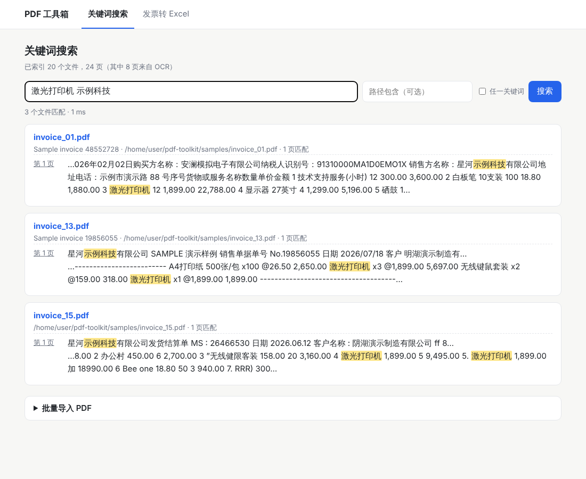
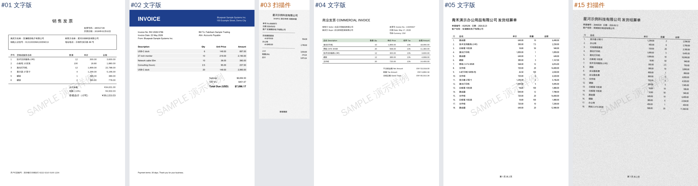
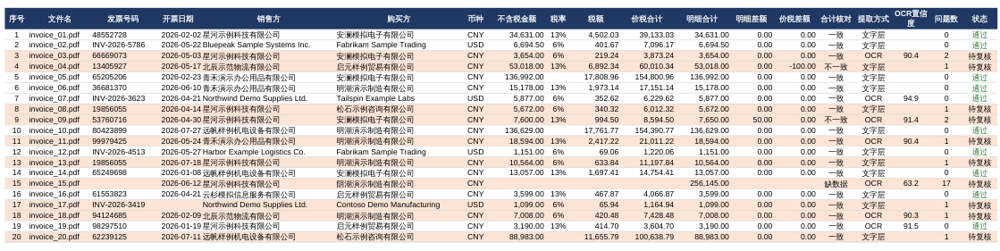

# PDF 工具箱 · pdf-toolkit

中文 | [English](README_en.md)

一个本地运行的 PDF 处理工具，包含两项功能，共用同一套 PDF 读取和 OCR 引擎：

| 功能 | 做什么 |
|---|---|
| **关键词搜索** | 把成百上千个 PDF 批量导入本地索引，中英文关键词毫秒级搜索，结果精确到页并高亮显示。**扫描件会自动 OCR**，同样可以搜到 |
| **发票转 Excel** | 批量识别发票（文字版和扫描件都可以），提取字段和明细，自动核对金额，生成带公式的 Excel 和"待复核"清单 |

两项功能可以联动：发票处理完后可以一键加入搜索索引，之后输入品名、公司名或发票号，就能搜出对应的是哪张发票的哪一页。

全部离线运行，不需要数据库服务器，不调用任何在线接口。可以用命令行，也可以用本地网页。


## 快速开始

需要 Python 3.10+。处理扫描件还需要 [Tesseract](https://github.com/tesseract-ocr/tesseract) 和简体中文语言包（Ubuntu：`apt install tesseract-ocr tesseract-ocr-chi-sim`；Windows 用 UB-Mannheim 的安装包）。不装 Tesseract 也能用，只是扫描件会被跳过并单独列出。

```bash
pip install -e .
pdftool serve                      # 打开 http://127.0.0.1:8000
```

命令行：

```bash
# 关键词搜索
pdftool index ~/资料 ~/合同                 # 导入（可重复执行，只处理新增和修改的文件）
pdftool search 机器学习 安全                 # 多个关键词须同时出现
pdftool search '"machine learning"' -综述   # 短语匹配，排除含"综述"的文件
pdftool search PID 卡尔曼 --any              # 任一关键词出现即可
pdftool stats                              # 索引统计、读取失败的文件、没有文字的文件

# 发票转 Excel
pdftool invoices 发票文件夹/ -o 发票汇总.xlsx           # 生成 Excel
pdftool invoices 发票文件夹/ -o 发票汇总.xlsx --index   # 同时加入搜索索引
```

索引默认存为当前目录下的 `pdfindex.db`，可以用 `--db 路径`（写在子命令前面）或环境变量 `PDFTOOL_DB` 指定。

## 功能一：关键词搜索



- **批量导入**：递归扫描文件夹，多进程并行处理；没有改动的文件会自动跳过。
- **扫描件 OCR**：页面没有文字层、但带有图片时，自动进行 OCR。处理步骤和发票功能共用：先纠偏，再分别对原图和降噪图做识别，取置信度更高的结果。只有一行字的短页面不会被误判为扫描件。之前在没有 OCR 的情况下导入过的扫描件，安装 Tesseract 后再导入一次就会被识别。
- **中英文搜索**：使用 SQLite FTS5 trigram 索引，中文不需要分词；被换行拆开的中文句子和用连字符断开的英文单词，在建索引前都会拼接好。
- **搜索语法**：空格分隔表示所有关键词须同时出现，`"引号"` 表示短语匹配，`-词` 表示排除包含该词的文件，`--any` 表示任一关键词即可，`--path` 按路径过滤。
- **性能**（1000 个 PDF、共 2 万页、4 核）：首次导入约 28 秒；再次导入（无变化）0.03 秒；生僻词搜索不到 2 毫秒；几乎每页都有的常见词 150–200 毫秒。测试脚本见 `demo/search_benchmark.py`。

## 功能二：发票转 Excel

演示使用 20 张模拟发票，共 5 种版式：中文销售发票、英文发票、小票、中英双语商业发票、两页结算单。其中 7 张是扫描件，第 15 张故意做得很差；另外人为埋了 6 个问题。



| | 文字版 PDF | 扫描件（OCR） |
|---|---|---|
| 表头字段 | **114/114（100%）** | 57/62（92%），错误全部来自第 15 张 |
| 明细行 | **121/121** | 去掉第 15 张后为 14/16 |
| 识别有误、却没有进入待复核的发票 | 0 | **0** |

**6 个埋设的问题全部被发现**：

- 价税合计写错；
- 明细之和与不含税金额不符；
- 重复发票（两张都会被标出）；
- 缺少开票日期；
- 税额笔误。这张发票上没有印税率，是通过"实际税率 13.10% 不是标准增值税率"发现的。

OCR 读错的地方同样会进入待复核：

- 置信度偏低的明细行标为"识别存疑"；其中有 1 行其实读对了，属于误报；
- 标签被 OCR 读成乱码的合计金额，按位置推断出来，标为"推断取值"；
- 整张扫描质量很差的发票，整体标为"扫描质量"。

完整评分见 [output/evaluation.md](output/evaluation.md)。

**生成的 Excel**（[output/发票汇总.xlsx](output/发票汇总.xlsx)）包含 5 个工作表：

- **发票汇总**：每张发票一行。明细合计、差额、核对结果、状态都是公式，人工修正数值后会自动重新计算。
- **明细**：每个明细行一行，"数量 × 单价"用公式重算，与金额不一致时标红。
- **待复核**：每条问题一行，带"处理结果"下拉列，供复核人填写。
- **合计核对**：按币种分别汇总，并与明细合计交叉核对。
- **说明**：各列含义和核对规则。

工作簿中共 455 个公式，用 LibreOffice 重新计算后错误数为 0。



**核对规则**：

- 必填字段：发票号码、开票日期、销售方、价税合计；
- 每行 数量 × 单价 = 金额；
- 明细之和 = 不含税金额；
- 不含税金额 + 税额 = 价税合计；
- 税额 = 不含税金额 × 税率；发票上没印税率时，按实际税率是否属于标准增值税率来判断；
- 重复发票；
- 日期是否在合理范围内；
- OCR 置信度。

金额容差为 0.01。

## 结构

```
pdftoolkit/
├── ocr.py              共用：页面文本行（文字层或 OCR）、扫描件判断、纠偏、双路 OCR
├── search/
│   ├── extract.py      逐页提取文字（扫描页走 OCR），拼接被换行拆开的文字
│   └── index.py        SQLite FTS5 索引、增量导入、查询解析、排序、摘要
├── invoices/
│   ├── reader.py       发票 → 文本行
│   ├── parse.py        按标签识别字段，按"数量 × 单价 = 金额"识别明细（不依赖版式）
│   ├── validate.py     核对规则 → 待复核清单
│   ├── excel.py        生成带公式、格式、下拉框、条件格式的 Excel
│   └── pipeline.py     批处理（多进程）
├── web.py              Flask 本地网页：两个标签页、后台任务、上传、下载
├── cli.py              pdftool 命令
└── templates/
demo/                   生成模拟发票、评分、生成截图、搜索性能测试
samples/                20 张模拟发票及标准答案 truth.json
output/                 演示产出的 Excel、JSON 和评分结果
tests/                  47 个测试
```

完整重现演示：

```bash
pip install -e ".[demo]"
python demo/generate.py --out samples
pdftool invoices samples -o output/发票汇总.xlsx --json output/extracted.json
python demo/evaluate.py samples output/extracted.json
pytest
```

## 局限

- 样例发票是合成的。真实发票（如增值税电子发票、全电发票）版式更多，可能需要补充标签词表。电子发票通常是文字版 PDF，是本项目识别最准确的一类。
- 扫描件中读错的品名无法通过算术核对发现，目前只能靠 OCR 置信度提示。阈值 85 是根据这批样例选定的，换成真实数据后需要重新校准。
- OCR 速度约为每页 2–4 秒。大量扫描件首次导入会比较慢，之后增量导入会跳过已处理的文件。
- 1–2 个字的搜索词用不上索引，需要逐页扫描，文件量很大时会变慢。
- 网页版只用于本机（默认只监听 127.0.0.1），它能读取服务进程有权限访问的任何文件夹，不要暴露到公网。

## 许可证

MIT。样例发票中的公司名称均为虚构，每张都带有"SAMPLE 演示样例"水印。
