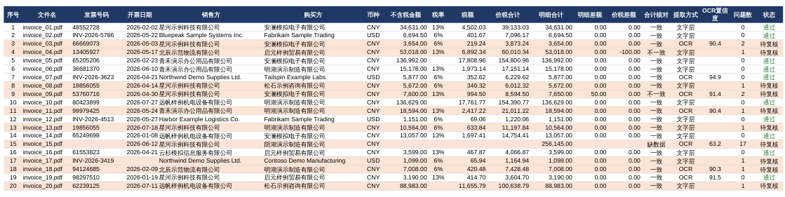

# pdf-toolkit

[中文](README.md) | English

pdf-toolkit is a local PDF toolkit with two tools. Both use the same PDF reading and OCR engine:

| Tool | What it does |
|---|---|
| **Keyword search** | Batch-index hundreds or thousands of PDFs and search them in Chinese or English in milliseconds. Each hit shows its page with highlighted matches. **Scanned PDFs are OCR'd automatically**, so they are searchable too |
| **Invoices → Excel** | Extract invoices, whether text PDFs or scans, into a workbook. Totals are reconciled with live formulas, and a review list collects everything that does not add up |

The two tools work together. Processed invoices can be added to the search index in one step, so you can later find an invoice by product name, company or invoice number.

Everything runs offline, with no database server and no online API. You can use it from the command line or through a local web page.


## Quick start

You need Python 3.10 or newer. Scans also need Tesseract with the `chi_sim` language pack. Without Tesseract, scans are skipped and listed separately.

```bash
pip install -e .
pdftool serve                                   # http://127.0.0.1:8000

pdftool index ~/papers                          # incremental, OCRs scanned pages
pdftool search machine learning                 # all keywords must appear
pdftool search '"gaussian process"' -survey     # phrase, excluding a word
pdftool invoices invoices/ -o invoices.xlsx --index   # Excel workbook, and add to the search index
```

## Keyword search

- **Incremental, parallel import.** Unchanged files are skipped.
- **Automatic OCR of scanned pages.** A page is treated as a scan when it has no text layer but contains an image; one-line text pages are left alone. Scans are deskewed and OCR'd twice, as-is and denoised, and the more confident reading is kept. Files indexed earlier without OCR are picked up once Tesseract is installed.
- **SQLite FTS5 trigram index.** Chinese needs no word segmentation, and lines broken by wrapping or hyphenation are joined before indexing.
- **Query syntax.** Space-separated keywords must all match, `"phrases"` match as a unit, `-word` excludes documents containing it, `--any` matches any keyword, and `--path` filters by path.
- **Speed.** On 1000 PDFs with 20,000 pages: first import 28 s on 4 cores, re-import 0.03 s, rare words under 2 ms, and words on nearly every page 150–200 ms.

## Invoices → Excel

The demo uses 20 mock invoices in 5 layouts. 7 are scans, and #15 is deliberately very poor. 6 problems are planted in the set.

| | Text PDFs | Scans (OCR) |
|---|---|---|
| Header fields | **114/114 (100%)** | 57/62 (92%), all misses on #15 |
| Line items | **121/121** | 14/16 excluding #15 |
| Invoices with an error that was *not* flagged | 0 | **0** |

All 6 planted problems are flagged:

- a wrong grand total
- a subtotal that does not match its line items
- a duplicate invoice
- a missing date
- a tax typo on an invoice that prints no rate, caught because the implied rate is not a statutory VAT rate

The workbook has five sheets: Summary, Line items, Review list, Totals per currency, and Legend. It contains 455 live formulas, and recalculating them in LibreOffice gives 0 errors. See [output/evaluation.md](output/evaluation.md) for the full scoring.



## Limitations

- **The sample invoices are synthetic.** Real layouts may need more label variants.
- **Misread descriptions on scans cannot be caught by arithmetic.** Row confidence is used as a proxy, with a threshold chosen on this sample set.
- **OCR is slow.** It takes about 2–4 s per page.
- **Very short search terms are slower.** Terms of one or two characters cannot use the trigram index and scan every page.
- **The web UI is for local use only.** It can read any folder the server process can read.

## License

MIT. All companies in the samples are fictional, and every sample invoice is watermarked "SAMPLE".
